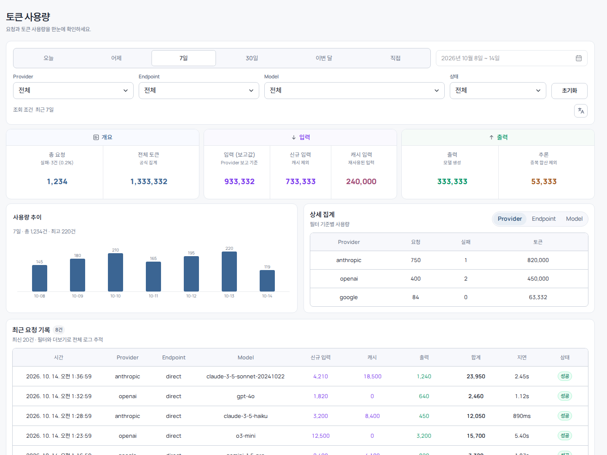
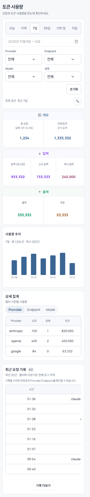

<p align="center"><a href="README.md">English</a> · <b>한국어</b></p>

<div align="center">
  <h1>cliproxyapi-plugin-usage-audit</h1>
  <p>CLIProxyAPI를 위한 토큰 사용량 감사·로그 집계 및 반응형 웹 대시보드(한국어/영어) 네이티브 Go 플러그인.</p>

  <p>
    <a href="https://go.dev" target="_blank" rel="noreferrer"></a>
    <a href="https://react.dev" target="_blank" rel="noreferrer"></a>
    <a href="https://github.com/dohwi/cliproxyapi-plugin-usage-audit/actions/workflows/verify.yml" target="_blank" rel="noreferrer"></a>
    <a href="LICENSE" target="_blank" rel="noreferrer"></a>
  </p>

  <p><a href="#preview">Preview</a> · <a href="#features">Features</a> · <a href="#getting-started">Getting Started</a> · <a href="#routes">Routes</a> · <a href="#language">Language</a> · <a href="#operations--tooling">Operations</a></p>
</div>

---

## Overview

`cliproxyapi-plugin-usage-audit`는 CLIProxyAPI 호스트에 직접 로드되는 `c-shared` C ABI 기반 네이티브 Go 플러그인입니다. 프록시를 통과하는 모든 LLM 요청의 토큰 사용량(입력·캐시·추론·출력·총합), 지연 시간, 상태 코드, 공급자/모델별 세부 통계를 비동기 링 버퍼를 통해 무손실로 캡처·영속화하고, 임베디드 반응형 대시보드로 시각화합니다.

## Preview

| Desktop Dashboard | Mobile View |
| :---: | :---: |
|  |  |

## Features

- **비동기 무손실 캡처**: 비차단 링 버퍼 큐와 백그라운드 워커를 통해 프록시 요청 지연 없이 사용량 로그 영속화.
- **다차원 토큰 집계**: Provider, Endpoint, Model, 상태(성공/실패), 일자별 요청 수 및 토큰 소비 통계 실시간 집계.
- **커서 기반 요청 로그 조회**: 역순 커서 페이지네이션 및 고성능 상위 K개 정렬 알고리즘 적용.
- **모던 반응형 대시보드**: React 19 및 Radix UI 기반의 정밀한 날짜 범위 선택기, 필터링, 반응형 테이블 레이아웃.
- **한국어/영어 UI**: 대시보드 헤더에서 언어를 전환합니다([Language](#language) 참고).
- **강건한 저장소 복구성**: 손상 라인 격리, 원자적 스냅샷 디코딩 및 안전한 로테이션 지원.
- **민감 정보 살균 도구 (Sanitizer)**: 키, 프롬프트 본문 등 민감 정보를 비파괴적으로 감사하고 정리할 수 있는 독립 CLI 도구 내장.

## Tech Stack

| Domain | Technology / Specification |
|---|---|
| Runtime & ABI | Go 1.26.9, cgo, C shared library (`.so` / `.dylib` / `.dll`) |
| Host Integration | CLIProxyAPI Plugin C ABI (`v7.2.155` SDK 의존성) |
| Embedded UI | React 19, Radix UI Primitives, esbuild 번들링 |
| Persistence | JSONL 로테이션 로그, 인메모리 스냅샷 캐시 |
| Bundled Typography | SUIT Regular/SemiBold, Manrope Variable (self-hosted WOFF2) |
| Verification | Go race/vet, Node 계약·i18n·인증 게이트 테스트, 모든 플랫폼의 Native C smoke test (`dlopen` / `LoadLibrary`) |

## Getting Started

플러그인은 CGO `c-shared` 라이브러리이므로 대상 플랫폼(Linux, macOS, Windows · amd64/arm64)에서 C 컴파일러(gcc 또는 clang)로 직접 빌드해야 합니다.

[mise](https://mise.jdx.dev)를 통해 로컬 런타임을 간편하게 부트스트랩할 수 있습니다:

```bash
# Managed runtimes
mise trust
mise install

# 네이티브 빌드 도구: Ubuntu/Debian
sudo apt-get update && sudo apt-get install -y build-essential
# macOS: xcode-select --install      Windows: 64비트 mingw-w64 gcc(예: MSYS2 UCRT64)와 Git Bash

# 테스트와 네이티브 ABI 스모크 테스트 (make가 없는 환경에서도 스크립트로 실행 가능)
make verify
scripts/build-native.sh
```

### Build

```bash
make build
```

빌드 결과물은 `artifacts/usage-audit.so`(macOS는 `.dylib`, Windows는 `.dll`)와 해당 헤더 파일로 생성됩니다.

### 대시보드 UI 다시 빌드

생성된 대시보드가 저장소에 포함되어 있어 일반 Go 빌드에는 프런트엔드 도구가 필요하지 않습니다. `ui/entry.tsx`나 vendor 컴포넌트를 바꾼 뒤에는 다시 생성합니다:

```bash
cd ui
npm ci
npm run build
```

`internal/plugin/dashboard.html`의 표시된 생성 영역이 갱신됩니다. 생성 영역은 직접 수정하지 마세요. 자세한 내용은 [ui/README.md](ui/README.md)를 참고하세요.

## Install

[CLIProxyAPI Plugins Store](https://github.com/router-for-me/CLIProxyAPI-Plugins-Store)에 등록되면 호스트의 플러그인 페이지에서 `usage-audit`를 설치할 수 있습니다. 수동 설치는 [최신 릴리스](https://github.com/dohwi/cliproxyapi-plugin-usage-audit/releases/latest)에서 `usage-audit_<version>_<os>_<arch>.zip`과 `checksums.txt`를 받아 `sha256sum -c checksums.txt`(macOS는 `shasum -a 256 -c`)로 확인한 뒤, 라이브러리를 호스트의 플러그인 디렉터리에 풉니다.

모든 릴리스는 스토어가 요구하는 5개 플랫폼을 함께 게시합니다. Release 워크플로는 5개가 모두 빌드되고 네이티브 스모크 테스트를 통과해야만 게시합니다.

| 플랫폼 | 에셋 | 라이브러리 |
|---|---|---|
| Linux x64 | `usage-audit_<version>_linux_amd64.zip` | `usage-audit.so` |
| Linux arm64 | `usage-audit_<version>_linux_arm64.zip` | `usage-audit.so` |
| macOS Intel | `usage-audit_<version>_darwin_amd64.zip` | `usage-audit.dylib` |
| macOS Apple silicon | `usage-audit_<version>_darwin_arm64.zip` | `usage-audit.dylib` |
| Windows x64 | `usage-audit_<version>_windows_amd64.zip` | `usage-audit.dll` |

Linux 빌드는 glibc 2.36 이하(공식 Debian bookworm 이미지)가 필요합니다.

### 데이터 디렉터리

사용량 기록은 호스트 프로세스의 `USAGE_AUDIT_DATA_DIR` 환경변수가 가리키는 디렉터리의 `usage.jsonl`(로테이션 시 `.1`, `.2`, ...)에 저장됩니다. 설정하지 않으면 사용자별 기본 경로 `<user-config-dir>/cliproxyapi/usage-audit`를 씁니다(Linux `~/.config/cliproxyapi/usage-audit`, macOS `~/Library/Application Support/cliproxyapi/usage-audit`, Windows `%AppData%\cliproxyapi\usage-audit`). 둘 다 사용할 수 없으면 저장소 없이 동작하며 로그를 남깁니다. 이전 빌드는 고정된 `/var/lib/homelab/...` 경로가 기본값이었으니, 기존 디렉터리를 계속 쓰려면 `USAGE_AUDIT_DATA_DIR`을 지정하세요.

### 릴리스

`internal/plugin/plugin.go`의 `pluginVersion`을 올려 `main`에 푸시하면 끝입니다. 릴리스 워크플로가 버전을 읽고, `vX.Y.Z`가 이미 있으면 건너뜁니다. 없으면 테스트 후 플랫폼별 네이티브 러너에서 빌드해 `<id>_<version>_<os>_<arch>.zip`으로 패키징하고, `checksums.txt`와 함께 태그와 GitHub 릴리스를 만듭니다. CLIProxyAPI 플러그인 스토어가 최신 릴리스를 읽으므로 플러그인 페이지에 업데이트가 표시됩니다.

같은 버전의 `vX.Y.Z` 태그를 직접 푸시하거나 워크플로를 수동 실행해도 됩니다. 버전은 점 구분 숫자(`vX.Y.Z`)이고 `pluginVersion`과 일치해야 하며, 5개 플랫폼이 모두 빌드되고 네이티브 스모크 테스트를 통과해야만 릴리스가 게시됩니다.

## Language

대시보드는 한국어와 영어를 지원하며, 필터 영역의 번역 아이콘 버튼 하나를 누를 때마다 한국어와 영어가 전환되며, 툴팁에 전환될 언어가 표시됩니다.

- **선택 순서**: 저장된 선택 → 브라우저 언어(한국어면 한국어, 그 외는 영어) → 한국어.
- **공유 설정**: 선택값은 브라우저의 `cpa_plugin_lang` 키에 저장되며, [quota-monitor](https://github.com/dohwi/cliproxyapi-plugin-quota-monitor) 대시보드와 같은 키를 씁니다. 한쪽에서 바꾸면 열려 있는 다른 쪽도 따라갑니다. 두 대시보드가 같은 origin에서 제공될 때만 적용됩니다.
- **개인정보**: 언어 키가 페이지가 `localStorage`에 쓰는 유일한 값입니다. 관리 키는 현재 탭의 `sessionStorage`에만 보관되며 `localStorage`, 쿠키, URL에는 쓰이지 않습니다.
- **번역되지 않는 항목**: 호스트 메뉴에 표시되는 플러그인 이름은 로드 시 한 번 등록되므로 플러그인 스토어 이름("Usage Audit")으로 고정되며 언어에 따라 바뀌지 않습니다.

## Routes

CLIProxyAPI 호스트 로드 후 아래 경로로 접근할 수 있습니다. 인증 없이 열리는 것은 정적 셸뿐이며 모든 사용량 데이터는 관리 키가 필요합니다:

| Method | Route | Description |
|---|---|---|
| `GET` | `/v0/resource/plugins/usage-audit/dashboard` | 사용량 감사 반응형 대시보드 페이지 (정적 셸, 데이터 없음) |
| `GET` | `/v0/management/plugins/usage-audit/data/summary` | 기간 및 필터 조건에 따른 집계 요약 (대시보드용) |
| `GET` | `/v0/management/plugins/usage-audit/data/records` | 커서 기반 세부 요청 로그 목록 (대시보드용) |
| `GET` | `/v0/management/plugins/usage-audit/dashboard` | 관리자 경로 대시보드 |
| `GET` | `/v0/management/plugins/usage-audit/summary` | 집계 요약 (관리 API) |
| `GET` | `/v0/management/plugins/usage-audit/records` | 세부 요청 로그 (관리 API) |
| `DELETE` | `/v0/management/plugins/usage-audit/records` | 저장된 기록 삭제 |

## Operations & Tooling

로그 파일에 민감 정보가 포함되어 있는지 비파괴적으로 검사하거나 살균할 수 있는 도구를 제공합니다:

```bash
# 샘플 데이터 드라이런 감사
make audit-dry-run

# 운영 로그 감사 (읽기 전용)
make audit-dry-run USAGE_LOG_PATH=/path/to/usage.jsonl

# 서비스 중지 경계 기반 안전 살균 드라이런
make boundary-sanitize-dry-run USAGE_LOG_PATH=/path/to/usage.jsonl
```

상세 운영 절차는 [Sanitization Runbook](docs/sanitization-runbook.md)을 참고하세요.

## Project Structure

```text
cliproxyapi-plugin-usage-audit/
├── main.go                     # c-shared C ABI 엔트리포인트 (usage.handle, management routes)
├── cmd/
│   └── usage-audit-sanitize/   # 로그 감사 및 민감정보 살균 독립 CLI 도구
├── internal/
│   ├── plugin/                 # 플러그인 수명주기, 대시보드 서빙, 상위 K 쿼리
│   │                           #   dashboard.html(생성 UI 영역), style.css, app.js
│   ├── queue/                  # 비차단 링 버퍼 큐 구현
│   └── store/                  # JSONL 파일 스토어, 로테이션, 스냅샷 디코더
├── ui/                         # React 대시보드 원본 소스 및 빌드 파이프라인
├── docs/                       # 대시보드 디자인, 구조적 견고화, 살균 런북
├── scripts/                    # 감사/살균 스크립트 및 UI 회귀 테스트
├── testdata/                   # 합성 사용량 샘플 데이터
├── verification/               # dlopen 기반 네이티브 C ABI 스모크 테스트
├── Makefile                    # 빌드, 검증, 스모크 테스트 타겟
└── THIRD_PARTY_NOTICES.md      # SDK 및 번들 폰트 라이선스 고지
```

## Documentation

- [Dashboard Design](docs/dashboard-design.md): 대시보드 UI/UX 아키텍처 및 상태 흐름
- [Structural Hardening](docs/structural-hardening.md): 저장소 장애 격리 및 큐 복구성 가이드
- [Sanitization Runbook](docs/sanitization-runbook.md): 운영 로그 살균 작업 절차서

## License

[MIT](LICENSE) — 저작권 및 라이선스 고지를 유지하면 상업적 이용을 포함해 자유롭게 사용·수정·배포할 수 있습니다.

이 플러그인이 의존하는 CLIProxyAPI SDK는 별도 프로젝트이며 자체 라이선스를 따릅니다. [THIRD_PARTY_NOTICES.md](THIRD_PARTY_NOTICES.md)를 참고하세요.

## Security & Attribution

- 실제 사용 로그, 계정 인증키, 프롬프트 원문은 저장소에 커밋하지 않습니다.
- CLIProxyAPI SDK 및 내장 폰트 라이선스는 [THIRD_PARTY_NOTICES.md](THIRD_PARTY_NOTICES.md)를 참고하세요.
