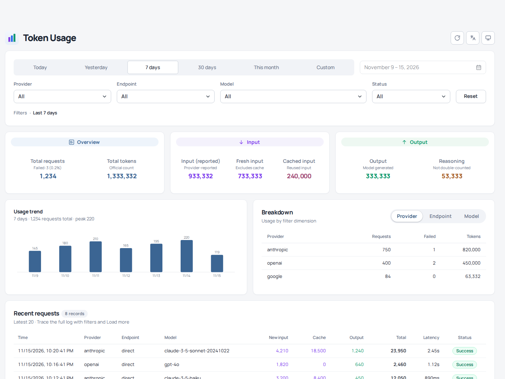
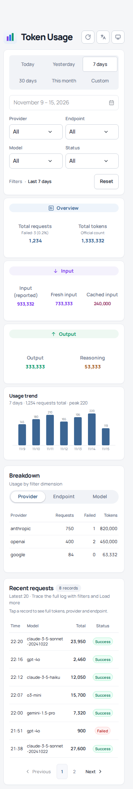

<p align="center"><b>English</b> · <a href="README.ko.md">한국어</a></p>

<div align="center">
  <h1>cliproxyapi-plugin-usage-audit</h1>
  <p>A native Go plugin for CLIProxyAPI that audits token usage and aggregates request logs, with a responsive bilingual (English/Korean) web dashboard.</p>

  <p>
    <a href="https://go.dev" target="_blank" rel="noreferrer"></a>
    <a href="https://react.dev" target="_blank" rel="noreferrer"></a>
    <a href="https://github.com/dohwi/cliproxyapi-plugin-usage-audit/actions/workflows/verify.yml" target="_blank" rel="noreferrer"></a>
    <a href="LICENSE" target="_blank" rel="noreferrer"></a>
  </p>

  <p><a href="#preview">Preview</a> · <a href="#features">Features</a> · <a href="#getting-started">Getting Started</a> · <a href="#routes">Routes</a> · <a href="#language">Language</a> · <a href="#operations--tooling">Operations</a></p>
</div>

---

## Overview

`cliproxyapi-plugin-usage-audit` is a `c-shared` C ABI native Go plugin that the CLIProxyAPI host loads directly. It captures and persists, without loss and through an asynchronous ring buffer, the token usage of every LLM request passing through the proxy (input, cache, reasoning, output and total), plus latency, status codes and per-provider/model statistics, and visualizes them in an embedded responsive dashboard.

## Preview

| Desktop Dashboard | Mobile View |
| :---: | :---: |
|  |  |

## Features

- **Asynchronous lossless capture**: a non-blocking ring-buffer queue and a background worker persist usage logs without adding latency to proxied requests.
- **Multi-dimensional token aggregation**: live totals by provider, endpoint, model and status (success/failure), plus daily request counts and token consumption.
- **Cursor-based request log**: reverse-cursor pagination with a high-performance top-K selection algorithm.
- **Modern responsive dashboard**: React 19 and Radix UI date-range picker, filters and responsive table layout.
- **Multilingual UI**: English, Korean and Simplified Chinese; follows the CLIProxyAPI console language by default, with a language menu in the dashboard header (see [Language](#language)).
- **Resilient storage**: quarantine of corrupt lines, atomic snapshot decoding and safe rotation.
- **Sanitizer tool**: a standalone CLI that non-destructively audits and cleans sensitive data such as keys and prompt bodies.

## Tech Stack

| Domain | Technology / Specification |
|---|---|
| Runtime & ABI | Go 1.26.9, cgo, C shared library (`.so` / `.dylib` / `.dll`) |
| Host Integration | CLIProxyAPI Plugin C ABI (`v8.0.72` SDK dependency) |
| Embedded UI | React 19, Radix UI primitives, esbuild bundle |
| Persistence | Rotating JSONL log, in-memory snapshot cache |
| Bundled Typography | SUIT Regular/SemiBold, Manrope Variable (self-hosted WOFF2) |
| Verification | Go race/vet, Node contract, i18n and auth-gate tests, native C smoke test (`dlopen` / `LoadLibrary`) on every platform |

## Getting Started

The plugin is a CGO `c-shared` library, so build it natively on the platform you target (Linux, macOS or Windows; amd64 or arm64) with a C compiler (gcc or clang).

Bootstrap the local runtimes with [mise](https://mise.jdx.dev):

```bash
# Managed runtimes
mise trust
mise install

# Native build tools: Ubuntu/Debian
sudo apt-get update && sudo apt-get install -y build-essential
# macOS: xcode-select --install      Windows: mingw-w64 gcc (MSYS2 UCRT64 on x64, CLANGARM64 on arm64) and Git Bash

# Run tests and the native ABI smoke test (the script also works where make is missing)
make verify
scripts/build-native.sh
```

### Build

```bash
make build
```

The build writes `artifacts/usage-audit.so` (`.dylib` on macOS, `.dll` on Windows) and the matching header.

### Rebuilding the dashboard UI

Normal Go builds do not need frontend tooling because the generated dashboard is checked in. After changing `ui/entry.tsx` or the vendored components, regenerate it:

```bash
cd ui
npm ci
npm run build
```

This rewrites the marked regions of `internal/plugin/dashboard.html`. Do not edit those generated regions by hand. See [ui/README.md](ui/README.md).

## Install

Once listed in the [CLIProxyAPI Plugins Store](https://github.com/router-for-me/CLIProxyAPI-Plugins-Store), install `usage-audit` from the host's plugin page. To install manually, download `usage-audit_<version>_<os>_<arch>.zip` and `checksums.txt` from the [latest release](https://github.com/dohwi/cliproxyapi-plugin-usage-audit/releases/latest), verify with `sha256sum -c checksums.txt` (`shasum -a 256 -c` on macOS), and unzip the library into the host's plugin directory.

Every release publishes all six store platforms; the Release workflow refuses to publish unless all of them built and passed the native smoke test:

| Platform | Asset | Library |
|---|---|---|
| Linux x64 | `usage-audit_<version>_linux_amd64.zip` | `usage-audit.so` |
| Linux arm64 | `usage-audit_<version>_linux_arm64.zip` | `usage-audit.so` |
| macOS Intel | `usage-audit_<version>_darwin_amd64.zip` | `usage-audit.dylib` |
| macOS Apple silicon | `usage-audit_<version>_darwin_arm64.zip` | `usage-audit.dylib` |
| Windows x64 | `usage-audit_<version>_windows_amd64.zip` | `usage-audit.dll` |
| Windows arm64 | `usage-audit_<version>_windows_arm64.zip` | `usage-audit.dll` |

The Linux builds require glibc 2.36 or older (the official Debian bookworm image).

### Data directory

Usage records are stored in `usage.jsonl` (rotated to `.1`, `.2`, ...) in the directory resolved in this order: the `USAGE_AUDIT_DATA_DIR` environment variable of the host process, then `data_dir` under `plugins.configs.usage-audit` in the host `config.yaml`, then a per-user default, `<user-config-dir>/cliproxyapi/usage-audit` (`~/.config/cliproxyapi/usage-audit` on Linux, `~/Library/Application Support/cliproxyapi/usage-audit` on macOS, `%AppData%\cliproxyapi\usage-audit` on Windows). **No setup is required**: the default works out of the box, and `strict_decoding: true` in the same plugin config enables strict record decoding. If none is available the plugin runs without storage and logs a message. Earlier builds defaulted to a fixed `/var/lib/homelab/...` path; set `USAGE_AUDIT_DATA_DIR` to keep using an existing directory.

Each record holds only token counts, timing, provider/model names and the stable credential index. It never stores the client API key, the host's usage `source` (which can be an upstream API key or an account e-mail), prompts or responses. Since 0.6.2 the plugin also removes `api_key_id` and `source` from history written by older versions when it opens the log.

### Releasing

Bump `pluginVersion` in `internal/plugin/plugin.go` and push to `main`. That is all: the Release workflow reads the version, skips if `vX.Y.Z` already exists, otherwise tests it, builds each platform on a native runner, packages `<id>_<version>_<os>_<arch>.zip`, writes `checksums.txt`, and creates the tag and GitHub release. The CLIProxyAPI plugin store reads the latest release, so the plugin page then offers the update.

Pushing a matching `vX.Y.Z` tag by hand, or running the workflow manually, also works. The version must be a dotted numeric version (`vX.Y.Z`) and match `pluginVersion`; a release is only published after all six platforms built and passed the native smoke test.

## Language

The dashboard ships in English, Korean and Simplified Chinese (`zh-CN`). The translate icon button in the header (and on the management-key screen) opens a language menu: **Follow CLIProxyAPI** (the default; the console's current language is shown next to it), then English, 한국어 and 简体中文.

- **Follows the console**: with "Follow CLIProxyAPI" the page uses the console language and switches live when it changes: Korean → Korean, any Chinese (`zh-CN`, and also `zh-TW`/`zh-HK`, which show Simplified Chinese because there is no Traditional Chinese translation) → Simplified Chinese, any other language → English. Outside the console the browser language is used the same way, then English.
- **Pinned language**: picking a language in the menu keeps it regardless of the console until "Follow CLIProxyAPI" is picked again.
- **Shared setting**: the choice is stored in the browser under `cpa_plugin_language` (`auto`, `en`, `ko` or `zh-CN`), the same key used by the other dohwi CLIProxyAPI plugin pages; changing it in one open page updates the others (same origin only). The keys of earlier versions (`cpa_plugin_lang`, `cpa_plugin_lang_host`) are no longer used, so every page starts on "Follow CLIProxyAPI".
- **Privacy**: the page writes only its language and theme-mode (system/light/dark) preferences to `localStorage`. The management key is held in `sessionStorage` for the current tab only and is never written to `localStorage`, cookies or a URL. For convenience it may read, never write, the key, theme and language the host Management Center already stores for the same origin (skipped when the host's "remember password" is off or its saved address is another origin).
- **Not translated**: the plugin name and sidebar tooltip shown by the host are registered once at load time, so the name is fixed to the plugin store name ("Usage Audit") and the tooltip shows both languages ("Token usage and request log dashboard · 토큰 사용량·요청 로그 대시보드").
- **Error messages**: API errors keep their English `error` text and add a stable `code`; the dashboard shows known codes in the selected language.

## Routes

Once the CLIProxyAPI host has loaded the plugin, these routes are available. Only the static shell is unauthenticated; all usage data requires the management key:

| Method | Route | Description |
|---|---|---|
| `GET` | `/v0/resource/plugins/usage-audit/dashboard` | Responsive usage audit dashboard (static shell, no data) |
| `GET` | `/v0/management/plugins/usage-audit/data/summary` | Aggregated summary for a period and filters (dashboard) |
| `GET` | `/v0/management/plugins/usage-audit/data/records` | Cursor-based request log (dashboard) |
| `GET` | `/v0/management/plugins/usage-audit/dashboard` | Dashboard on the management path |
| `GET` | `/v0/management/plugins/usage-audit/summary` | Aggregated summary (management API) |
| `GET` | `/v0/management/plugins/usage-audit/records` | Request log (management API) |
| `DELETE` | `/v0/management/plugins/usage-audit/records` | Clear stored records |

## Operations & Tooling

Tools to audit or sanitize log files for sensitive data without modifying them in place:

```bash
# Dry-run audit against the sample data
make audit-dry-run

# Audit an operational log (read-only)
make audit-dry-run USAGE_LOG_PATH=/path/to/usage.jsonl

# Safe sanitize dry-run based on a service-stop boundary
make boundary-sanitize-dry-run USAGE_LOG_PATH=/path/to/usage.jsonl
```

See the [Sanitization Runbook](docs/sanitization-runbook.md) for the full procedure.

## Project Structure

```text
cliproxyapi-plugin-usage-audit/
├── main.go                     # c-shared C ABI entry point (usage.handle, management routes)
├── cmd/
│   └── usage-audit-sanitize/   # Standalone log audit and sanitizer CLI
├── internal/
│   ├── plugin/                 # Plugin lifecycle, dashboard serving, top-K queries
│   │                           #   dashboard.html (generated UI regions), style.css, app.js
│   ├── queue/                  # Non-blocking ring-buffer queue
│   └── store/                  # JSONL file store, rotation, snapshot decoder
├── ui/                         # React dashboard sources and build pipeline
├── docs/                       # Dashboard design, structural hardening, sanitization runbook
├── scripts/                    # Release packaging, native build, audit/sanitize scripts and UI regression tests
├── testdata/                   # Synthetic usage sample data
├── verification/               # Cross-platform native C ABI smoke test (dlopen / LoadLibrary)
├── Makefile                    # Build, verify and smoke-test targets
└── THIRD_PARTY_NOTICES.md      # SDK and bundled font license notices
```

## Documentation

- [Dashboard Design](docs/dashboard-design.md): dashboard UI/UX architecture and state flow
- [Structural Hardening](docs/structural-hardening.md): storage fault isolation and queue recovery guide
- [Sanitization Runbook](docs/sanitization-runbook.md): procedure for sanitizing operational logs

## License

[MIT](LICENSE). You may use, modify, distribute and sell this software, including commercially, as long as the copyright and license notice are kept.

The CLIProxyAPI SDK this plugin depends on is a separate project under its own license; see [THIRD_PARTY_NOTICES.md](THIRD_PARTY_NOTICES.md).

## Security & Attribution

- Real usage logs, account keys and prompt bodies are never committed to this repository.
- CLIProxyAPI SDK and bundled font licenses are listed in [THIRD_PARTY_NOTICES.md](THIRD_PARTY_NOTICES.md).
