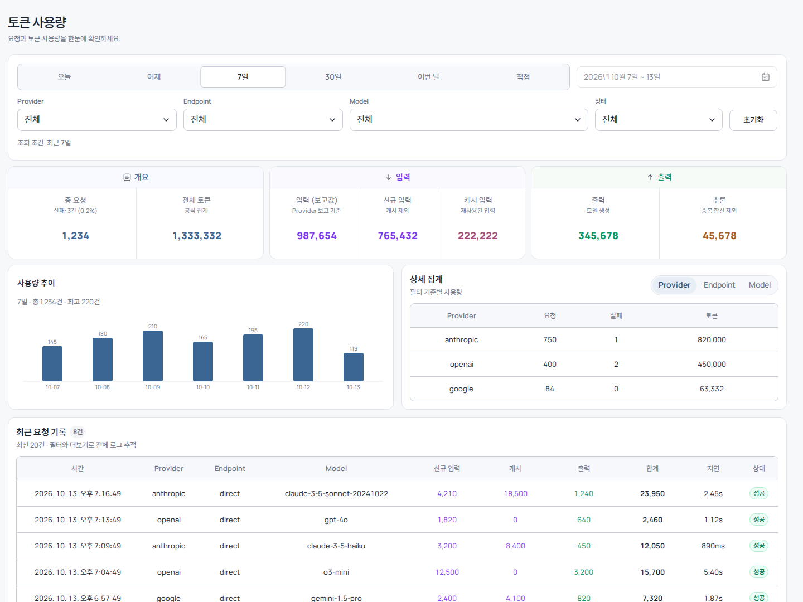
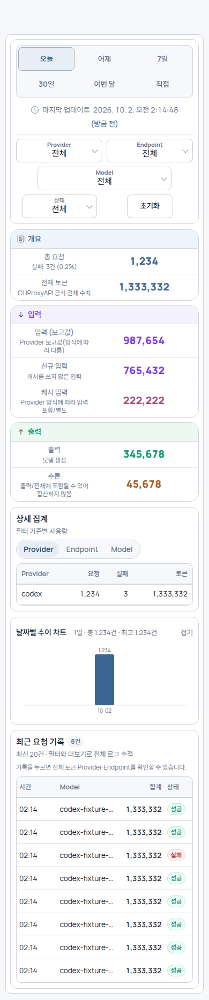

<div align="center">
  <h1>cliproxyapi-plugin-usage-audit</h1>
  <p>CLIProxyAPI를 위한 토큰 사용량 감사·로그 집계 및 반응형 웹 대시보드 네이티브 Go 플러그인.</p>

  <p>
    <a href="https://go.dev" target="_blank" rel="noreferrer"></a>
    <a href="https://react.dev" target="_blank" rel="noreferrer"></a>
    <a href="https://github.com/dohwi/cliproxyapi-plugin-usage-audit/actions/workflows/verify.yml" target="_blank" rel="noreferrer"></a>
    <a href="https://www.docker.com" target="_blank" rel="noreferrer"></a>
  </p>

  <p><a href="#preview">Preview</a> · <a href="#features">Features</a> · <a href="#getting-started">Getting Started</a> · <a href="#routes">Routes</a> · <a href="#operations">Operations</a></p>
</div>

---

## Overview

`cliproxyapi-plugin-usage-audit`는 CLIProxyAPI 호스트에 직접 로드되는 `c-shared` C ABI 기반 네이티브 Go 플러그인입니다. 프록시를 통과하는 모든 LLM 요청의 토큰 사용량(입력·캐시·추론·출력·총합), 지연 시간, 상태 코드, 공급자/모델별 세부 통계를 비동기 링 버퍼를 통해 무손실로 캡처·영속화하고, 임베디드 반응형 대시보드로 시각화합니다.

## Preview

| Desktop Dashboard | Mobile View |
| :---: | :---: |
|  |  |

## Features

- **비동기 무손실 캡처**: 비차단 링 버퍼 큐와 백그라운드 워커를 통해 프록시 요청 지연 없이 사용량 로그 영속화.
- **다차원 토큰 집계**: Provider, Endpoint, Model, 상태(성공/실패), 일자별 요청 수 및 토큰 소비 통계 실시간 집계.
- **커서 기반 요청 로그 조회**: 역순 커서 페이지네이션 및 고성능 상위 K개 정렬 알고리즘 적용.
- **모던 반응형 대시보드**: React 19 및 Radix UI 기반의 정밀한 날짜 범위 선택기, 필터링, 반응형 테이블 레이아웃.
- **강건한 저장소 복구성**: 손상 라인 격리, 원자적 스냅샷 디코딩 및 안전한 로테이션 지원.
- **민감 정보 살균 도구 (Sanitizer)**: 키, 프롬프트 본문 등 민감 정보를 비파괴적으로 감사하고 정리할 수 있는 독립 CLI 도구 내장.

## Tech Stack

| Domain | Technology / Specification |
|---|---|
| Runtime & ABI | Go 1.26.5, cgo, C shared library (`.so`) |
| Host Integration | CLIProxyAPI Plugin C ABI (`v7.2.155` SDK 의존성) |
| Embedded UI | React 19, Radix UI Primitives, esbuild 번들링 |
| Persistence | JSONL 로테이션 로그, 인메모리 스냅샷 캐시 |
| Bundled Typography | SUIT Regular/SemiBold, Manrope Variable (self-hosted WOFF2) |
| Verification | Go race/vet, Node 계약 검증, Native C smoke test (`dlopen`) |

## Getting Started

호스트 프로세스와 동일한 OS·아키텍처·C 런타임 환경(Linux amd64 glibc)에서 빌드해야 합니다.

[mise](https://mise.jdx.dev)를 통해 로컬 런타임을 간편하게 부트스트랩할 수 있습니다:

```bash
# Managed runtimes
mise trust
mise install

# Ubuntu/Debian native build tools
sudo apt-get update && sudo apt-get install -y build-essential

# Run tests and native ABI smoke test
make verify
make native-smoke
```

### Build

```bash
make build
```

빌드 결과물은 `artifacts/usage-audit.so` 및 헤더 파일 `artifacts/usage-audit.h`로 생성됩니다.

## Routes

CLIProxyAPI 호스트 로드 후 아래 리소스 및 관리 경로로 접근할 수 있습니다:

| Method | Route | Description |
|---|---|---|
| `GET` | `/v0/resource/plugins/usage-audit/dashboard` | 사용량 감사 반응형 웹 대시보드 |
| `GET` | `/v0/resource/plugins/usage-audit/data/summary` | 기간 및 필터 조건에 따른 집계 요약 |
| `GET` | `/v0/resource/plugins/usage-audit/data/records` | 커서 기반 세부 요청 로그 목록 |
| `GET` | `/v0/management/plugins/usage-audit/dashboard` | 관리자 경로 대시보드 |
| `GET` | `/v0/management/plugins/usage-audit/summary` | 관리자 경로 집계 요약 |
| `GET` | `/v0/management/plugins/usage-audit/records` | 관리자 경로 세부 요청 로그 |

## Operations & Tooling

로그 파일에 민감 정보가 포함되어 있는지 비파괴적으로 검사하거나 살균할 수 있는 도구를 제공합니다:

```bash
# 샘플 데이터 드라이런 감사
make audit-dry-run

# 운영 로그 감사 (읽기 전용)
make audit-dry-run USAGE_LOG_PATH=/path/to/usage.jsonl

# 서비스 중지 경계 기반 안전 살균 드라이런
make boundary-sanitize-dry-run USAGE_LOG_PATH=/path/to/usage.jsonl
```

상세 운영 절차는 [Sanitization Runbook](docs/sanitization-runbook.md)을 참고하세요.

## Project Structure

```text
cliproxyapi-plugin-usage-audit/
├── main.go                     # c-shared C ABI 엔트리포인트 (usage.handle, management routes)
├── cmd/
│   └── usage-audit-sanitize/   # 로그 감사 및 민감정보 살균 독립 CLI 도구
├── internal/
│   ├── plugin/                 # 플러그인 수명주기, 대시보드 서빙, 상위 K 쿼리
│   ├── queue/                  # 비차단 링 버퍼 큐 구현
│   └── store/                  # JSONL 파일 스토어, 로테이션, 스냅샷 디코더
├── ui/                         # React 대시보드 원본 소스 및 빌드 파이프라인
├── docs/                       # 대시보드 디자인, 구조적 견고화, 살균 런북
├── scripts/                    # 감사/살균 스크립트 및 UI 회귀 테스트
├── testdata/                   # 합성 사용량 샘플 데이터
├── verification/               # dlopen 기반 네이티브 C ABI 스모크 테스트
├── Makefile                    # 빌드, 검증, 스모크 테스트 타겟
└── THIRD_PARTY_NOTICES.md      # SDK 및 번들 폰트 라이선스 고지
```

## Documentation

- [Dashboard Design](docs/dashboard-design.md): 대시보드 UI/UX 아키텍처 및 상태 흐름
- [Structural Hardening](docs/structural-hardening.md): 저장소 장애 격리 및 큐 복구성 가이드
- [Sanitization Runbook](docs/sanitization-runbook.md): 운영 로그 살균 작업 절차서

## Security & Attribution

- 실제 사용 로그, 계정 인증키, 프롬프트 원문은 저장소에 커밋하지 않습니다.
- CLIProxyAPI SDK 및 내장 폰트 라이선스는 [THIRD_PARTY_NOTICES.md](THIRD_PARTY_NOTICES.md)를 참고하세요.
