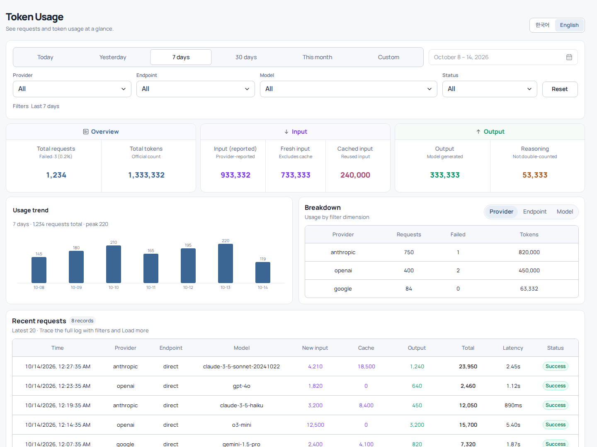
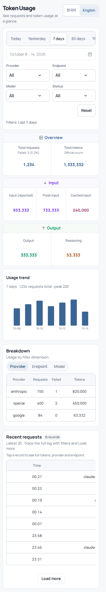

<p align="center"><b>English</b> · <a href="README.ko.md">한국어</a></p>

<div align="center">
  <h1>cliproxyapi-plugin-usage-audit</h1>
  <p>A native Go plugin for CLIProxyAPI that audits token usage and aggregates request logs, with a responsive bilingual (English/Korean) web dashboard.</p>

  <p>
    <a href="https://go.dev" target="_blank" rel="noreferrer"></a>
    <a href="https://react.dev" target="_blank" rel="noreferrer"></a>
    <a href="https://github.com/dohwi/cliproxyapi-plugin-usage-audit/actions/workflows/verify.yml" target="_blank" rel="noreferrer"></a>
    <a href="LICENSE" target="_blank" rel="noreferrer"></a>
  </p>

  <p><a href="#preview">Preview</a> · <a href="#features">Features</a> · <a href="#getting-started">Getting Started</a> · <a href="#routes">Routes</a> · <a href="#language">Language</a> · <a href="#operations--tooling">Operations</a></p>
</div>

---

## Overview

`cliproxyapi-plugin-usage-audit` is a `c-shared` C ABI native Go plugin that the CLIProxyAPI host loads directly. It captures and persists, without loss and through an asynchronous ring buffer, the token usage of every LLM request passing through the proxy (input, cache, reasoning, output and total), plus latency, status codes and per-provider/model statistics, and visualizes them in an embedded responsive dashboard.

## Preview

| Desktop Dashboard | Mobile View |
| :---: | :---: |
|  |  |

## Features

- **Asynchronous lossless capture**: a non-blocking ring-buffer queue and a background worker persist usage logs without adding latency to proxied requests.
- **Multi-dimensional token aggregation**: live totals by provider, endpoint, model and status (success/failure), plus daily request counts and token consumption.
- **Cursor-based request log**: reverse-cursor pagination with a high-performance top-K selection algorithm.
- **Modern responsive dashboard**: React 19 and Radix UI date-range picker, filters and responsive table layout.
- **Bilingual UI**: English and Korean, switchable from the dashboard header (see [Language](#language)).
- **Resilient storage**: quarantine of corrupt lines, atomic snapshot decoding and safe rotation.
- **Sanitizer tool**: a standalone CLI that non-destructively audits and cleans sensitive data such as keys and prompt bodies.

## Tech Stack

| Domain | Technology / Specification |
|---|---|
| Runtime & ABI | Go 1.26.9, cgo, C shared library (`.so`) |
| Host Integration | CLIProxyAPI Plugin C ABI (`v7.2.155` SDK dependency) |
| Embedded UI | React 19, Radix UI primitives, esbuild bundle |
| Persistence | Rotating JSONL log, in-memory snapshot cache |
| Bundled Typography | SUIT Regular/SemiBold, Manrope Variable (self-hosted WOFF2) |
| Verification | Go race/vet, Node contract and i18n tests, native C smoke test (`dlopen`) |

## Getting Started

Build on the same OS, architecture and C runtime as the host process (Linux amd64, glibc).

Bootstrap the local runtimes with [mise](https://mise.jdx.dev):

```bash
# Managed runtimes
mise trust
mise install

# Ubuntu/Debian native build tools
sudo apt-get update && sudo apt-get install -y build-essential

# Run tests and the native ABI smoke test
make verify
make native-smoke
```

### Build

```bash
make build
```

The build writes `artifacts/usage-audit.so` and the header `artifacts/usage-audit.h`.

### Rebuilding the dashboard UI

Normal Go builds do not need frontend tooling because the generated dashboard is checked in. After changing `ui/entry.tsx` or the vendored components, regenerate it:

```bash
cd ui
npm ci
npm run build
```

This rewrites the marked regions of `internal/plugin/dashboard.html`. Do not edit those generated regions by hand. See [ui/README.md](ui/README.md).

## Install

Once listed in the [CLIProxyAPI Plugins Store](https://github.com/router-for-me/CLIProxyAPI-Plugins-Store), install `usage-audit` from the host's plugin page. To install manually, download `usage-audit_<version>_linux_amd64.zip` and `checksums.txt` from the [latest release](https://github.com/dohwi/cliproxyapi-plugin-usage-audit/releases/latest), run `sha256sum -c checksums.txt`, and unzip `usage-audit.so` into the host's plugin directory.

The Linux build targets glibc 2.36 or older (the official Debian bookworm image). Only `linux/amd64` is published; other platforms must build from source.

## Language

The dashboard ships in English and Korean. A single translate icon button in the filter area switches between Korean and English; its tooltip names the language it switches to.

- **Selection order**: saved choice, then browser language (Korean selects Korean, anything else selects English), then Korean.
- **Shared setting**: the choice is stored in the browser under `cpa_plugin_lang`, the same key used by the [quota-monitor](https://github.com/dohwi/cliproxyapi-plugin-quota-monitor) dashboard. Changing it in one open dashboard updates the other. This only applies when both dashboards are served from the same origin.
- **Privacy**: this key is the only thing the page writes to browser storage.
- **Not translated**: the plugin name shown in the host menu is registered once at load time, so it stays Korean ("토큰 사용량").

## Routes

Once the CLIProxyAPI host has loaded the plugin, these resource and management routes are available:

| Method | Route | Description |
|---|---|---|
| `GET` | `/v0/resource/plugins/usage-audit/dashboard` | Responsive usage audit dashboard |
| `GET` | `/v0/resource/plugins/usage-audit/data/summary` | Aggregated summary for a period and filters |
| `GET` | `/v0/resource/plugins/usage-audit/data/records` | Cursor-based request log |
| `GET` | `/v0/management/plugins/usage-audit/dashboard` | Dashboard on the management path |
| `GET` | `/v0/management/plugins/usage-audit/summary` | Aggregated summary on the management path |
| `GET` | `/v0/management/plugins/usage-audit/records` | Request log on the management path |

## Operations & Tooling

Tools to audit or sanitize log files for sensitive data without modifying them in place:

```bash
# Dry-run audit against the sample data
make audit-dry-run

# Audit an operational log (read-only)
make audit-dry-run USAGE_LOG_PATH=/path/to/usage.jsonl

# Safe sanitize dry-run based on a service-stop boundary
make boundary-sanitize-dry-run USAGE_LOG_PATH=/path/to/usage.jsonl
```

See the [Sanitization Runbook](docs/sanitization-runbook.md) for the full procedure.

## Project Structure

```text
cliproxyapi-plugin-usage-audit/
├── main.go                     # c-shared C ABI entry point (usage.handle, management routes)
├── cmd/
│   └── usage-audit-sanitize/   # Standalone log audit and sanitizer CLI
├── internal/
│   ├── plugin/                 # Plugin lifecycle, dashboard serving, top-K queries
│   │                           #   dashboard.html (generated UI regions), style.css, app.js
│   ├── queue/                  # Non-blocking ring-buffer queue
│   └── store/                  # JSONL file store, rotation, snapshot decoder
├── ui/                         # React dashboard sources and build pipeline
├── docs/                       # Dashboard design, structural hardening, sanitization runbook
├── scripts/                    # Audit/sanitize scripts and UI regression tests
├── testdata/                   # Synthetic usage sample data
├── verification/               # dlopen-based native C ABI smoke test
├── Makefile                    # Build, verify and smoke-test targets
└── THIRD_PARTY_NOTICES.md      # SDK and bundled font license notices
```

## Documentation

- [Dashboard Design](docs/dashboard-design.md): dashboard UI/UX architecture and state flow
- [Structural Hardening](docs/structural-hardening.md): storage fault isolation and queue recovery guide
- [Sanitization Runbook](docs/sanitization-runbook.md): procedure for sanitizing operational logs

## License

[MIT](LICENSE). You may use, modify, distribute and sell this software, including commercially, as long as the copyright and license notice are kept.

The CLIProxyAPI SDK this plugin depends on is a separate project under its own license; see [THIRD_PARTY_NOTICES.md](THIRD_PARTY_NOTICES.md).

## Security & Attribution

- Real usage logs, account keys and prompt bodies are never committed to this repository.
- CLIProxyAPI SDK and bundled font licenses are listed in [THIRD_PARTY_NOTICES.md](THIRD_PARTY_NOTICES.md).
